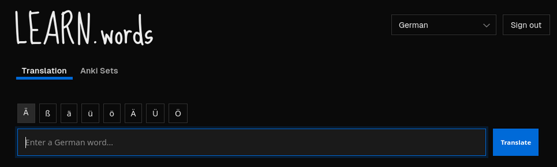
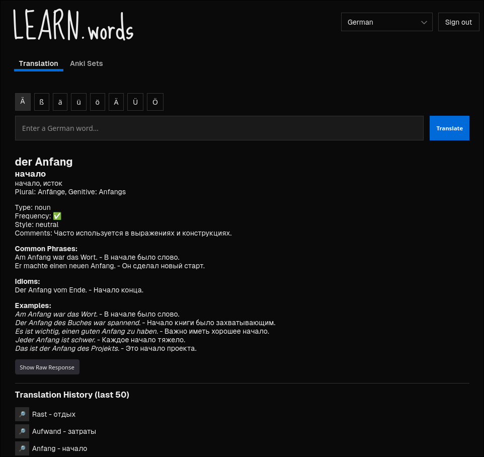

# Gooseberry



Gooseberry is a vocabulary app for translating words, phrases and short sentences, saving useful entries, studying them here, and exporting them to Anki.

The goal is not just to return a direct translation, but to give enough context to actually learn the word: grammar notes, frequency, usage comments, word forms, and example sentences.

## What It Does

- Translates input with learning-focused context instead of a minimal dictionary-style answer
- Saves recent translation history
- Organizes saved items into Anki sets
- Runs native study sessions with independent FSRS scheduling for five exercise directions
- Imports Anki vocabulary decks with field/template mapping, learning-progress continuation, resumable text batches and omitted media
- Generates selected missing fields on request, with editable proposals before saving
- Exports study material for Anki in `.csv` and `.apkg` formats

## Supported Translation Directions

Source and target selectors support 21 configured languages, including Finnish,
Russian, English, German and Norwegian. See the current
[language list](src/components/ui/Languages.ts).

## Interface Preview

The main screen is built around fast input, quick character insertion for language-specific letters, and one-click translation.



## Export Options

### `.apkg` Export Behavior

`.apkg` exports include the `Gooseberry Vocabulary v1` note type, its structured fields, styling, and five card templates:

- Recognition: source word to translation
- Production: translation to source word
- Word forms, when forms are available
- Example recall, when an example and its translation are available
- Typed production using Anki's native answer comparison

Each vocabulary item is one Anki note. Its applicable study cards are siblings, so Anki can bury related cards and an edit to the note updates every variant. Stable note identities allow later exports to update previously imported notes.

### CSV Export

CSV is the portable fallback.
It preserves more than just the source word and translation, including examples, grammar details, and word forms, but requires manual field mapping to an existing Anki note type.

## Study in Gooseberry

Native study uses the same five exercise directions as export: recognition,
production, word forms, typed production and example recall. Each exercise has
its own stable card identity and FSRS schedule while sharing the editable
vocabulary item. Forms/examples appear when the required content is present;
removing that content preserves their review histories. Existing recognition
progress is retained. Typed-answer feedback supports self-rating; the chosen
rating determines the next review.

Scheduled due reviews come first. New exercises follow word order in rounds,
rotating exercise types across words so a word's siblings are spaced apart.

See [Native review architecture](docs/native-review-architecture.md). Gooseberry
uses its built-in scheduler settings, without automatic sibling burying or a daily
new-exercise limit.

## Import Anki Vocabulary

Choose **Import Anki deck** in the set library. Preview a local `.apkg`, choose
decks and languages, and map each note type before importing. Media is omitted;
only bounded text batches reach the server. **Keep Anki learning progress**
defaults on. Confirm source-template matches and the study timezone: matching
exercises retain converted due dates, intervals and counters, while additional
exercise types start new. Suspension and unexpired burial are respected.
Source reviews and presets remain private; future ratings use Gooseberry's
scheduler.

Missing fields can remain empty. Edit them or use **Generate missing content**
to review an AI proposal before saving. Reimport into the same set skips existing
source notes, preserves local edits/progress and can recover Anki progress for
untouched exercises. See the
[import behavior and limits](docs/anki-import.md) and
[analysis of the supplied personal export](docs/anki-personal-export-analysis.md).

## Development

Use Node 26.3.0 (see `.nvmrc`) and pnpm 11.6.0 (pinned in `package.json`).
`pnpm-lock.yaml` is the dependency lockfile.
Vercel's install and build commands explicitly use pnpm 11.6.0 in `vercel.json`
to avoid its legacy package-manager auto-detection. Update those commands together
with `packageManager` when changing pnpm versions.

```sh
pnpm install --frozen-lockfile
pnpm dev
```

Run `pnpm test`, `pnpm typecheck`, `pnpm lint`, and `pnpm build` to validate changes.
The production build needs network access to download the Google font.

Apply the SQL migrations in order using the existing database workflow. Import
and enrichment require `0009_anki_text_import.sql`,
`0010_requested_enrichment.sql` and `0011_imported_study_progress.sql` before
deploying this version. Migration 0011 does not automatically convert older
imports; reimport into the existing set to recover untouched progress. They are not
applied to a remote database by development, build or test commands. Tests use
local SQLite/PGlite fixtures and mocked AI calls.

Install/dev/build prepares the local SQL.js WASM used by the import worker.
`ENRICHMENT_DAILY_TOKEN_LIMIT` defaults to 100,000 reserved tokens per user per
UTC day; zero disables new generation. `OPENAI_ENRICHMENT_MODEL` optionally
overrides `OPENAI_TRANSLATION_MODEL` (default `gpt-5-mini`). See
[usage and quota details](docs/admin-and-quotas.md) before changing limits.

Linting uses Oxlint with the migrated Next.js, TypeScript, React, import, and
accessibility rules in `.oxlintrc.json`. Prettier remains the formatter. The React
Compiler rules are explicitly enabled to preserve the previous checks; their
Oxlint implementations are experimental. Existing application lint findings are
still reported as errors or warnings, rather than suppressed during migration.

The migration preserves 80 rules, with two coverage gaps: Next.js's
`no-location-assign-relative-destination` is not implemented in Oxlint, and
`react/no-deprecated` needs the separate type-aware `typescript/no-deprecated`
rule. JSX variable tracking is built in; the old React Compiler `config` and
`gating` rules do not apply to Oxlint's fixed compiler configuration.

TypeScript 7 runs `pnpm typecheck` and the Next.js build's type checks through
`experimental.useTypeScriptCli`. Test helpers explicitly import
`@typescript/typescript6` for its `transpileModule` API, which TypeScript 7.0 does
not provide. The two packages expose separate `tsc` and `tsc6` commands. Keep the
compatibility package until those helpers no longer need the TypeScript 6 API.
Node types follow the Node 26 runtime, and NextAuth stays on the v5 beta release
track.
