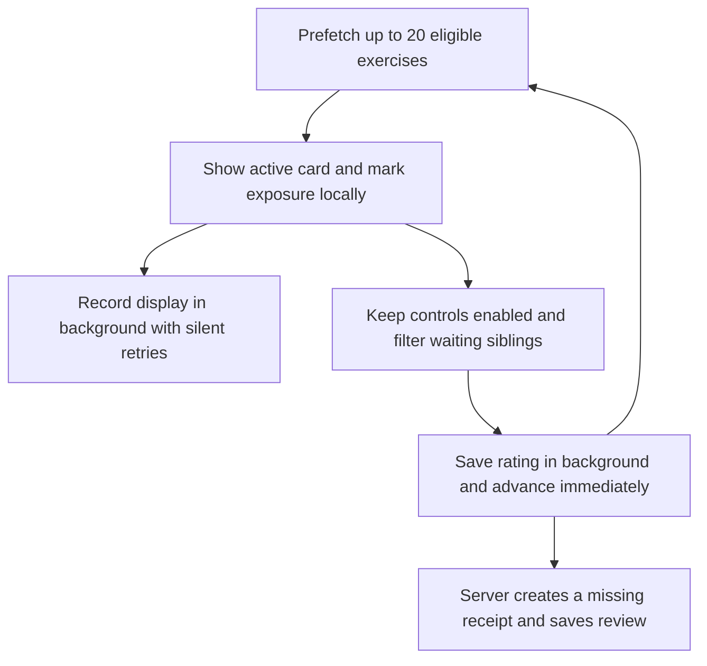

# Native review architecture

## Notes and exercise identities

A user-owned `word_set` groups vocabulary under one language pair. A `word_set_item` holds the editable note content and its stable Anki export GUID. Each item has five `study_card` identities, unique by item and template key.

| Key           | Prompt → answer                     | Required fields             |
| ------------- | ----------------------------------- | --------------------------- |
| `recognition` | Source → translation                | Source and translation      |
| `production`  | Translation → source                | Source and translation      |
| `word_forms`  | Source → word forms                 | Source and forms            |
| `type_answer` | Translation → typed source          | Source and translation      |
| `example`     | Translated example → source example | Example and its translation |

[The shared registry](../src/lib/review/templates.ts) defines these directions and availability for native study and APKG export. Empty fields hide only dependent exercises. All identities and histories remain intact, so restoring content resumes the same cards. Deleting a note cascades to its cards and reviews.

Imported and library-edited notes retain structured example pairs, including unmatched text. The first complete pair supplies the example exercise; legacy notes without pairs use their stored example fields. Imported notes can retain an empty source/translation while awaiting an edit or explicit generation.

Library summaries distinguish words, available exercises and due exercises. Per-word review summaries aggregate available siblings; they do not replace their independent schedules.

## Scheduling and queue order

Each exercise has its own canonical `review_event` history and replaceable `fsrs_card_state` projection. Events record the learner, card UUID, rating, time and optional duration/source metadata; replay orders them by review time and sequence. Imported progress can also supply a durable `study_card_import_baseline`. Replay starts from that baseline and applies only native events; an exercise without starting progress or review history is new. Creating a card never fabricates reviews.

[The versioned FSRS adapter](../src/lib/review/fsrs.ts) calculates rating previews and state transitions on the server. Imported progress preserves the current schedule through a versioned conversion; subsequent ratings use Gooseberry's built-in settings rather than source presets. Imported suspension and unexpired burial exclude cards from queues, due counts and review submission. Reviewing one sibling does not alter the others.

Scheduled due reviews precede new exercises, globally earliest due first across the study scope. New notes start with recognition; its first saved introduction unlocks production, whose first saved introduction unlocks typing, forms, and example exercises. Within each set, New material uses that fixed type order, then note position; combined scopes take fair rounds from those streams with stable set/card tie breakers. Prerequisites are checked before batching/exclusions and again on submission; existing studied directions keep their own schedules even if an earlier type has never been studied. Canonical native history, imported studied baselines, and current projections preserve these decisions across cache rebuilds.

Profile study settings default to 20 new words per day per set, currently resetting at midnight in the saved study time zone. Unseen notes need an available recognition card to enter the daily cohort; optional content alone cannot reserve a slot. Started words retain their unlocked siblings and due repetitions are uncapped by that allowance. See the [study-order walkthrough](study-order.md) and [revision checklist](study-flow-revision-plan.md#implementation-checklist).

## Study scopes and routes

`/study?scope=all` includes every owned set across language pairs. Explicit selections use `scope=sets&set=<uuid>` with repeated `set` parameters; one ID is single-set study. Add `filter=due_only` to exclude New exercises while retaining due Learning/Review/Relearning. The library toolbar offers Study all, Repeat all, and Custom study on the left, with import/create actions on the right. Button heights match, and the heading, description, and section/set separators are omitted. Custom study uses the existing native move-dialog shell and shared searchable picker with checkboxes; its footer offers Cancel, Repeat due only, and Study. The main set list has no selection checkboxes or allowance/settings description.

`GET /api/study/queue` validates 1–100 explicit UUIDs, normalizes duplicates, and rejects empty, foreign, missing, or deleted selections. It reconciles the scope in bulk, applies eligibility before LIMIT, and returns global timing metadata. Search and the translation screen's language pair do not narrow the all-sets scope. Note/card identity, history, and exposure remain shared across every scope.

`POST /api/study/activate` and `/api/study/reviews` derive the owned set from the card; each card supplies its own language pair for rendering/audio. Existing single-set pages and API routes wrap the common implementation, with legacy API writes retaining their set constraint. The reviewer preserves scope/filter on refills, invalidates readiness after displays, and invalidates both readiness and the future global `studyActivity` cache after saved grades. Rewards/activity storage remains planned.

## Exposure and the 2 am reset

Every displayed study card attempts to update its note's `last_exposed_at`, including ungraded or abandoned prompts. Prefetch and statistics reads do not. Only recognition, production and typing in Review/Relearning check that marker: any exposure since the current study day's 2 am boundary defers them until the next boundary. New/Learning and forms/examples ignore this gate but still record exposure. A 10-minute Learning return remains available; a sensitive Relearning return after Again waits until the next study day. Only New shows Ok; grading controls are unchanged.

[`studyDay.ts`](../src/db/studyDay.ts) resolves boundaries in the saved study time zone, defaulting to UTC. PostgreSQL moves a nonexistent spring 2 am past the gap and uses the later fall occurrence. The daily new-word allowance still resets at midnight. Exposure eligibility uses the note UUID; separately saved duplicate words remain independent.

[`studyExposurePolicy.ts`](../src/db/studyExposurePolicy.ts) filters before the queue limit and selects at most one due sensitive sibling per note before exclusions. Earliest due wins, with recognition/production/typing and UUID tie breakers. Forms/examples and initial-learning cards are retained. Ready counts apply the exposure gate to individual cards; these are a snapshot, not a forecast of how many will remain after further exposures. Effective availability is the latest of FSRS due, burial expiry and applicable exposure reset; the stored FSRS due date is unchanged.

## Persistence and sessions

Authenticated routes validate ownership and eligible card identities. The browser displays the active prefetched prompt immediately, marks exposure locally and sends `POST /api/study/activate` with `displayed: true` in the background. Reading, typing, reveal, rating and advancement never wait for that request. Buttons stay enabled; errors are retried silently. Retries reuse the presentation UUID; focus and rollover can renew visibility across 2 am without clearing an answer, including while the first response is pending. Late responses never replace the visible prompt.

This removes per-card confirmation waits while retaining 20-card batches. Cross-tab/device exposure exclusion is best effort. If a buffered prompt becomes stale, its exposure request still records the actual display using an owner-scoped marker update, and its response does not interrupt the exercise. A request lost before reaching the server can lose an unconfirmed exposure. Waiting candidates are never activated early to hide network latency.

Rating POSTs carry the client-generated presentation `exposureId`. If its receipt is missing because the display request was lost or is still in flight, the server creates it during the grade request without consulting prior exposure. New-word allowance, prerequisites, ownership, due/suspension checks and projection revision guards still apply. The repository reads the current projection, calculates the next state, then atomically appends its event, conditionally updates the projection by revision, consumes the receipt and renews exposure. A missing exposure confirmation does not reject a grade; an existing mismatched or consumed receipt remains invalid. The Neon HTTP driver uses atomic batches rather than interactive callback transactions. Repeated submissions reuse their event UUID and do not create duplicate reviews.

Activation repairs only the active card's missing/outdated projection, and only new recognition needs the set's unseen-word cohort check. It does not reconcile all set identities or refetch library statistics per display. Receipts use keyed lookups; exposure eligibility reads only the note timestamp. Receipts currently remain until their note/account is deleted; timed receipt cleanup and production throughput benchmarking are not implemented.

The common session at `/study` (also reached through `/anki/[id]/review`) shows the exercise direction, prompt and revealed answer. New exercises have an introduction control; existing exercises use simple/full self-rating controls, interval previews and keyboard shortcuts. Typed comparison normalizes Unicode, whitespace and case while retaining accents and punctuation. After reveal, a grapheme-level diff marks incorrect typed fragments in red with strikethrough and missing/corrected answer fragments in green with underline. It provides feedback; the learner's chosen rating controls scheduling.

Show/Check answer and ratings share a fixed bottom panel, outside the scrolling card and its reveal animation. Long answers and comments remain in the document; the reusable layout reserves the measured panel height so the last lines are reachable. Advancing returns to the next word at the top. See [fixed bottom controls and Reader reuse](bottom-panel-layout.md).

Study mode hides the global site header, retaining a compact set/language strip and End session link to the normal library. The card is borderless, with matching compact prompt/answer sizes and readable supporting text. Removing large section padding and minimum heights keeps the answer close to the prompt without hiding long comments. The bottom panel uses the existing darker input surface.

Only the type-in answer field requests disabled autocomplete, autocorrection, capitalization, spellchecking and writing suggestions. These are browser/keyboard hints; device settings can override them. See the [HTML writing-suggestions specification](https://html.spec.whatwg.org/multipage/interaction.html#writing-suggestions).

The browser prefetches exercises and saves ratings in the background. A local exposure map filters late refill responses. Focus and the 2 am timer refresh the visible prompt's exposure and queue availability independently. Exposure errors do not affect the interface; failed grade writes retain their existing retry/ignore toast. Pending writes live only in memory; see [review request handling and durability](optimistic-review-updates.md). Synthetic pronunciation is a separate user action.

## Import and content edits

[APKG import](anki-import.md) publishes notes, all five card identities and eligible converted progress in one atomic batch. Progress import defaults on, with editable source-template matches and study timezone. Due dates, intervals and counters carry over only to matching exercise types; additional modes start new. Valid source FSRS memory is reused, or SM2 interval/ease estimate it. Private source tables retain original notes/cards, schedules, review logs and collection/preset configuration separately from native events.

Reimport can seed untouched existing exercises, but a native event, projection or prior baseline prevents replacement. Undo deletes only notes created by that import; progress attached to preexisting notes remains. Deleting a projection or replaying after a scheduler-version change retains the imported baseline.

Content edits update shared note fields without replacing exercise UUIDs. A content revision protects concurrent manual/proposal saves, and field provenance records imported, generated or edited text. Requested enrichment fills only reviewed, still-empty fields; enabling an exercise does not reset sibling progress.

The word's action menu offers **Move to another set**. Its native modal shares the searchable `WordSetPicker` and cached set query with the translation save dropdown. All owned sets are listed; the current set and different language pairs are unavailable, with reasons. Cancel/Escape leave the word unchanged. Move posts to `/api/word-sets/[id]/items/[itemId]/move`, which validates both set owners/languages again and updates the note's membership in an atomic batch. The word is appended to the destination; its UUID, export GUID, content, card identities, schedules, review history, imported baseline and exposure marker remain intact. Retries after a lost response do not copy or reposition it again. An imported-note identity collision returns a conflict rather than merging or deleting history. Moving clears the note's original import-undo ownership so undoing that import cannot delete the relocated word; its source key and study baseline are retained.

APKG export writes one Gooseberry note with applicable sibling templates. Its historical template ordinals are stable. The export GUID is separate from an imported source GUID; export does not reproduce arbitrary source templates or imported progress.

## Database requirements

Migration `0005` establishes review tables and recognition identities. Migration [`0008_multi_exercise_study_cards.sql`](../migrations/0008_multi_exercise_study_cards.sql) backfills the other directions while preserving existing recognition UUIDs, events and schedules. Owner-scoped reconciliation also creates missing identities when statistics/queues are read, without generating FSRS state.

Import/content metadata requires [`0009`](../migrations/0009_anki_text_import.sql); requested enrichment requires [`0010`](../migrations/0010_requested_enrichment.sql). Migration [`0011`](../migrations/0011_imported_study_progress.sql) adds imported baselines, progress options, suspension and burial. It does not convert previously imported notes automatically; reimport into their existing set to recover untouched progress. New notes receive all five identities in the same atomic batch as their content. Development/build/test commands do not apply these migrations to remote databases.

Migration [`0012`](../migrations/0012_study_set_settings.sql) adds the profile's daily new-word limit and study time zone. Apply it before deploying the updated queue/profile code.

Migration [`0013`](../migrations/0013_study_exposure.sql) adds the note timestamp and authorization receipts. Apply the complete SQL before deploying this reviewer; a schema-only push omits the backfill. The backfill uses only retained native reviews belonging to the note's owner, across every card type. Historical ungraded displays are unavailable and imported source reviews do not mark exposure.
