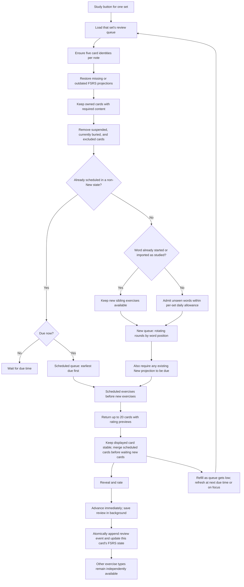
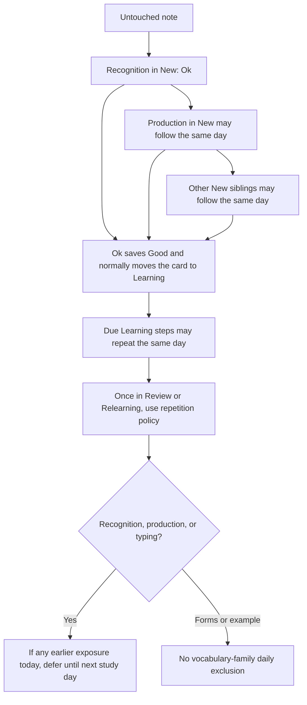

# Study exercises: current behavior and revision plan

Audited on **9 November 2026**, against working-tree code at commit `28f7fd1` (`Use blue reader borders and vertical action menus`). This is an analysis and implementation proposal; application behavior has not been changed.

**Confirmed policy:** for this exposure feature, **New and Learning are initial learning; Review and Relearning are repetition**. Every displayed study card records exposure. Only recognition, production, and typing in Review/Relearning consult earlier same-day exposure and defer until the next day when any exists. New/Learning cards and forms/examples ignore this gate but still record exposure. Learning returns, including the same card's 10-minute step, remain available when due. Existing Ok/grading controls are unchanged. **The exposure restriction resets at 2 am in the saved study time zone**, not after a rolling 24 hours.

## 1. Findings and recommended direction

The two ordering problems are present in the code. New exercises deliberately rotate their starting type by the word's position, so recognition is not always first. Siblings have independent schedules and are not automatically separated by session or day.

My suggested starting policy is:

1. Introduce every genuinely new word with **source → target recognition**.
2. Introduce **target → source production** as its second new exercise type. It may be introduced on the same day as recognition; keep introductory siblings apart with other notes when possible, without imposing a next-day gate.
3. Record **every display** as note exposure. Only **recognition, production, or typing in Review/Relearning** check for earlier exposure today and defer if any exists. **New and Learning** are initial learning for this feature and bypass this gate, allowing same-day siblings and due Learning returns. Forms/examples bypass it in every state. All allowed displays still record exposure.
4. Keep each exercise's FSRS state and history. Separate introduction order and daily availability from memory scheduling.
5. Award **one leaf for every 20 saved exercise completions**, across all study sets and exercise types. Show today's leaves, partial progress, history, and a daily streak.
6. Offer the same study engine for **one set, several selected sets, or all sets**, with a **due only** filter.

Recognition-first, the New/Learning initial-learning boundary for this feature, and the any-exposure repetition gate reflect the user's requirements. Leaves, combined study scopes, and the other product defaults remain proposals where identified below.

## 2. The five exercises currently implemented

Here, **source** means the set's `sourceLang` / note's `original`; **target** means `targetLang` / `translation`. Those names describe the stored language pair, which is not necessarily the learner's native-language direction.

| Registry order | Key / label                     | Prompt → answer                        | Available when                                | Interaction                     |
| -------------- | ------------------------------- | -------------------------------------- | --------------------------------------------- | ------------------------------- |
| 1              | `recognition` / Recognition     | Source word → target translation       | `original` and `translation` are nonblank     | Think, reveal, self-rate        |
| 2              | `production` / Production       | Target translation → source word       | `original` and `translation` are nonblank     | Think, reveal, self-rate        |
| 3              | `word_forms` / Word forms       | Source word → its forms                | `original` and `wordForms` are nonblank       | Think, reveal, self-rate        |
| 4              | `type_answer` / Type the source | Target translation → typed source word | `original` and `translation` are nonblank     | Type, check, compare, self-rate |
| 5              | `example` / Example recall      | Translated example → source example    | `sample` and `sampleTranslation` are nonblank | Think, reveal, self-rate        |

The “grammar” exercise is currently **word-form recall**, not a separate grammar-question generator. Example recall asks for the source sentence; it is not a gap-fill exercise. One stored example pair supplies this exercise, rather than generating a card for every example pair.

A note owns five stable `study_card` identities. Missing content hides dependent exercises without deleting their identity/history. A note with only source and translation therefore has **three available exercises**, including typing; a complete note has five. Each exercise has a separate `fsrs_card_state` and separate `review_event` history.

Definitions: [template registry](../src/lib/review/templates.ts), [content eligibility and identity reconciliation](../src/db/studyCardRepo.ts), [note/card/history schema](../src/db/schema.ts), and [example-field mapping](../src/app/utils/cardDraft.ts).

### What the user sees when answering

- A new exercise offers **Ok**, submitting FSRS **Good**. “New” is per exercise, so production can show this introduction control even after recognition has been studied.
- Existing exercises use **No / Yes → Again / Good** in Simple mode, or **Hard / Good / Easy / Again** in Full mode.
- The typed-answer comparison provides feedback; it does not automatically choose the rating.
- Word-form and example prompts also show the word's target translation when present.
- After revealing most exercises, the answer area also shows **word forms and the example pair**, when present, plus comments. This matters for the independence question below.

Code: [rating controls](../src/lib/review/controls.ts), [exercise rendering](../src/components/review/ReviewSession.tsx), and [typed-answer comparison](../src/components/review/exercises.ts).

## 3. Current queue: end-to-end chart



### Server filtering and exact sort

`getDueReviewCards` in [reviewRepo.ts](../src/db/reviewRepo.ts) currently:

1. Scopes the query to the authenticated owner and **one set ID**.
2. Checks required content, suspension, `buriedUntil`, daily word eligibility, and client-supplied excluded **card IDs**.
3. Requires no FSRS projection, or `dueAt <= now`.
4. Sorts non-New scheduled cards first, including learning, relearning, and established reviews.
5. Within scheduled cards, sorts by earliest due time.
6. Then sorts by exercise round, note `position`, and card UUID.

Cards with imported projections still in FSRS **New** are ordered as new exercises. Current SQL does not give learning/relearning a separate priority over older overdue established reviews. The repository clamps fetch limits to 1–50; the route requests 20.

### The actual order of new exercises

The registry cycle is:

`recognition → production → word_forms → type_answer → example → recognition`

For zero-based note position `p`, `exerciseRoundOrder()` starts at **`p mod 5`**. It counts applicable siblings before each card in this rotated cycle. Missing content compresses the rounds. The queue traverses notes in position order for round 1, then repeats for round 2, etc.

For five untouched notes with complete content, read each row left to right, then the next row:

| Round | Word A: position 0 | Word B: position 1 | Word C: position 2 | Word D: position 3 | Word E: position 4 |
| ----- | ------------------ | ------------------ | ------------------ | ------------------ | ------------------ |
| 1     | Recognition        | Production         | Word forms         | Type the source    | Example recall     |
| 2     | Production         | Word forms         | Type the source    | Example recall     | Recognition        |
| 3     | Word forms         | Type the source    | Example recall     | Recognition        | Production         |
| 4     | Type the source    | Example recall     | Recognition        | Production         | Word forms         |
| 5     | Example recall     | Recognition        | Production         | Word forms         | Type the source    |

With only source and translation, two untouched notes at positions 0 and 1 produce:

```text
A recognition
→ B production
→ A production
→ B type_answer
→ A type_answer
→ B recognition
```

This is explicitly asserted by [studyCardQueries.test.mjs](../tests/studyCardQueries.test.mjs), in the test beginning at line 320. It directly explains issue 1.

This chart describes a fresh queue with all these cards available. Due repetitions, missing fields, suspension/burial, and completed or buffered cards can change the actual sequence. Rounds include applicable siblings already answered or prefetched, so exclusions do not restart the rotation.

### What happens over time

The [FSRS adapter](../src/lib/review/fsrs.ts) uses `ts-fsrs@5.4.2`, 90% desired retention, learning steps of **1 and 10 minutes**, a **10-minute** relearning step, and no fuzz. A new card's Ok/Good currently schedules its first repetition for **10 minutes later**. Later intervals depend on that card's state and chosen rating.

There is no fixed daily sequence such as “recognition today, production tomorrow.” Every exercise can become due independently. A future card is not shown early. The client refreshes at the next scheduled due time and on window focus, including from the completion view. It keeps the active prompt stable while putting incoming due repetitions ahead of waiting new material.

Saving recognition only updates recognition. It does not postpone production, typing, word forms, or examples. A note's other cards can appear later in the same session, potentially very close together in a small set.

### Three separate quantities that should stay distinct

| Quantity                         | Current meaning                                 | Effect                                                                  |
| -------------------------------- | ----------------------------------------------- | ----------------------------------------------------------------------- |
| **20 cards per response**        | Network/prefetch batch size                     | Does not end the session after 20 answers                               |
| **20 new words per day per set** | Default profile allowance; configurable 0–1,000 | Limits wholly unseen notes, not repetitions or number of exercise types |
| **20 completions per leaf**      | Requested new reward rule                       | Not implemented yet                                                     |

The current allowance resets at midnight in the saved study time zone, default UTC. The first saved native review for a previously unseen note consumes one word slot. Fetching does not consume it. The cohort is selected before batching/exclusions, preventing a refill from opening another cohort. Started notes keep their siblings available; imported studied notes do not spend today's new-word allowance. The allowance is independent for each set.

Code: [studyAllowance.ts](../src/db/studyAllowance.ts), [settings.ts](../src/lib/review/settings.ts), [profileRepo.ts](../src/db/profileRepo.ts), and [profile settings](../src/components/profile/ProfileClient.tsx).

## 4. Current implementation map

Line numbers refer to this audit's revision; names identify the relevant implementation if lines later move.

| Concern                                             | File / entry point                                              | Location                                                                                                   |
| --------------------------------------------------- | --------------------------------------------------------------- | ---------------------------------------------------------------------------------------------------------- |
| Exercise keys, directions, required fields          | [templates.ts](../src/lib/review/templates.ts)                  | `STUDY_CARD_TEMPLATE_KEYS`, line 1; definitions, line 32                                                   |
| Stable identities and content availability          | [studyCardRepo.ts](../src/db/studyCardRepo.ts)                  | `eligibleStudyCardCondition`, line 18; `availableStudyCardCondition`, line 45; `ensureStudyCards`, line 54 |
| Card creation when saving words                     | [wordSetRepo.ts](../src/db/wordSetRepo.ts)                      | `addItemsToWordSet`, line 83; five-card insert, line 118                                                   |
| Due filtering and ordering                          | [reviewRepo.ts](../src/db/reviewRepo.ts)                        | `getDueReviewCards`, line 91; `exerciseRoundOrder`, line 163                                               |
| Daily new-word admission                            | [studyAllowance.ts](../src/db/studyAllowance.ts)                | `studyWordAvailabilityCondition`, line 12                                                                  |
| Next due timestamp                                  | [reviewRepo.ts](../src/db/reviewRepo.ts)                        | `getNextScheduledReviewAt`, line 129                                                                       |
| Ratings → FSRS transitions                          | [fsrs.ts](../src/lib/review/fsrs.ts)                            | Scheduler config, line 6; `applyReview`, line 75                                                           |
| New/simple/full buttons                             | [controls.ts](../src/lib/review/controls.ts)                    | `reviewControls`, line 24                                                                                  |
| Review API and batch size                           | [review route](../src/app/api/word-sets/[id]/review/route.ts)   | `REVIEW_QUEUE_SIZE`, line 32; GET, line 34; POST, line 88                                                  |
| Single-set page                                     | [review page](../src/app/anki/[id]/review/page.tsx)             | `ReviewSession wordSetId={id}`, line 23                                                                    |
| Client buffering and exclusion IDs                  | [ReviewSession.tsx](../src/components/review/ReviewSession.tsx) | `loadCards`, line 105                                                                                      |
| Save retries and immediate advance                  | [ReviewSession.tsx](../src/components/review/ReviewSession.tsx) | `sendReview`, line 200; `submitRating`, line 288                                                           |
| Due timer and focus refresh                         | [ReviewSession.tsx](../src/components/review/ReviewSession.tsx) | Effects, lines 256 and 274                                                                                 |
| Queue merge priority                                | [queue.ts](../src/lib/review/queue.ts)                          | `shouldRefillReviewQueue`, line 8; `mergeReviewQueue`, line 21                                             |
| Prompt, answer, and supporting content              | [ReviewSession.tsx](../src/components/review/ReviewSession.tsx) | Prompt, line 490; supporting forms/examples after reveal, line 632                                         |
| Durable review write and deduplication              | [reviewRepo.ts](../src/db/reviewRepo.ts)                        | `recordReview`, line 186; `getRecordedReviewState`, line 253; `persistReview`, line 439                    |
| Imported-history projection recovery                | [reviewProjectionRepo.ts](../src/db/reviewProjectionRepo.ts)    | `ensureReviewProjections`, line 32                                                                         |
| Ready counts for sets and notes                     | [reviewStatsRepo.ts](../src/db/reviewStatsRepo.ts)              | Note summaries, line 31; set summaries, line 102                                                           |
| Set list and current Study links                    | [WordSetList.tsx](../src/components/anki/WordSetList.tsx)       | Component, line 35; individual Study link, line 301                                                        |
| Per-set detail Study action                         | [WordSetManager.tsx](../src/components/anki/WordSetManager.tsx) | Review navigation, line 417                                                                                |
| Stored preferences, identities, events, projections | [schema.ts](../src/db/schema.ts)                                | Preferences, line 50; cards, line 219; events, line 258; projections, line 310                             |
| Stable Anki export identities                       | [apkgExporter.ts](../src/lib/anki/apkgExporter.ts)              | `GOOSEBERRY_TEMPLATE_KEYS_BY_ORD`, line 14                                                                 |

The current plant graphic represents **how many exercises are ready**, through `plantReadinessStage()` in [stats.ts](../src/lib/review/stats.ts) and [StudyPlant.tsx](../src/components/review/StudyPlant.tsx). It is not a leaf wallet or completed-work tracker. There is currently no persistent study-session/chunk model, daily leaf total, heatmap, or streak implementation in this study flow.

## 5. Proposed exercise progression

### Recognition first, with same-day introductions and Learning steps

Remove the position-based exercise rotation and enforce prerequisites through a shared study policy, including when cards are buffered or fetched concurrently.

For a genuinely untouched note:

1. Recognition is the first exercise shown.
2. Its first successful saved introduction unlocks production **without waiting for another day**. Production is the second introduced type, before optional types when it is valid and available.
3. After production, a practical introduction order is `type_answer → word_forms → example`; the relative order of these last three remains a tunable preference. Skip missing optional content, allowing it to become eligible when added later.
4. Multiple **New introductions** may share a day. Interleave other notes when possible, without imposing a mandatory daily separation on introductions.
5. After Ok, a card normally enters Learning. For this feature it remains in **initial learning**: its 10-minute return and other due Learning steps may appear the same day, even after another sibling has been shown. All those displays still record exposure.

Keep introduction order in a dedicated policy constant; do not change registry identity keys or Anki export ordinals.



The second introduced type need not be the second graded attempt: a due Learning step may appear before a New production introduction. Both can occur that day regardless of prior exposure. There is no requirement to wait for recognition to graduate to Review before introducing production.

Preserve existing and imported progress during rollout. Apply recognition-first to genuinely unseen notes without resetting existing production/example schedules. Use the new introduction order for remaining types where applicable.

If a fresh note lacks a valid recognition card, show that it needs source/translation content rather than introducing it through forms/examples. Suspended or buried recognition should not be bypassed. Likewise, do not silently bypass a temporarily unavailable required production stage. Already-started cards retain their schedules if prerequisite content is later removed.

### Confirmed feature boundary: New/Learning versus Review/Relearning

For this feature, initial learning means `state === New || state === Learning`; repetition means Review or Relearning. Keep this policy separate from the [rating controls](../src/lib/review/controls.ts): only New shows Ok, while Learning continues to use grading buttons. Changing the exposure-policy phase does not change the buttons.

| Feature phase    | FSRS state       | Existing buttons           | Exposure rule                                                               |
| ---------------- | ---------------- | -------------------------- | --------------------------------------------------------------------------- |
| Initial learning | `New` (0)        | Ok → Good                  | Ignore prior exposure; record display                                       |
| Initial learning | `Learning` (1)   | No/Yes or full grading     | Ignore prior exposure; allow due same-day steps; record display             |
| Repetition       | `Review` (2)     | No/Yes or full grading     | Recognition/production/typing defer after any earlier exposure today        |
| Repetition       | `Relearning` (3) | No/Yes or full grading     | Same gate as Review for those three types                                   |
| Grammar/examples | Any state        | Buttons still follow state | Ignore prior exposure; record display and block later sensitive repetitions |

Classify the attempt by its state **before applying the rating**. New → Learning after Ok stays within initial learning for this feature. An attempt displayed in Learning can be saved normally even if its rating moves the card into Review; subsequent Review attempts consult prior exposure. A Review → Relearning lapse stays in repetition and does not bypass the gate. Classification is per card, not per note age or calendar date.

Existing tests in [reviewControls.test.mjs](../tests/reviewControls.test.mjs) confirm the unchanged button boundary: only New gets Ok, while Learning, Review, and Relearning get grading controls. Add separate tests for the exposure feature's broader New/Learning initial phase; do not widen `isNewState()` or reuse it as this feature's phase definition.

### Queue priority

Keep due work ahead of introductions. Prefer due short Learning/Relearning steps over an established review backlog as an explicit improvement to current behavior. **Learning bypasses the exposure gate; Relearning consults it for sensitive card types.** Within New introductions, enforce recognition, then production, then remaining types, interleaving notes when practical.

For competing sensitive repetitions of an unexposed note, prefer the earliest due card; break ties with policy order and stable ID. Exclusions and prefetch do not authorize a display: recheck exposure at activation. Once any card is shown, all waiting sensitive repetitions of that note become unavailable for the rest of the day, including repeats of the same card. New/Learning cards and forms/examples stay eligible under this gate.

## 6. Confirmed rule: track every exposure; gate only selected repetitions

Every actual study-card presentation records exposure to its note, regardless of card type, FSRS phase, answer reveal, rating, or eventual save success. A prefetched card that has not been displayed is not an exposure. Routine rerenders and revealing the current answer belong to the same presentation, not new attempts.

Only candidates satisfying **both** conditions consult today's exposure history:

1. Their pre-answer FSRS state is **Review or Relearning**. New and Learning are initial learning for this feature and do not consult the gate.
2. Their type is recognition, production, or typing (`type_answer`).

If that note has **any earlier exposure today**, defer such a candidate until the next study day. All other candidates ignore this daily gate but still record their own exposure when displayed. Existing ownership, content, suspension/burial, due-time, allowance, and introduction-order checks continue to apply.

```ts
const exposureSensitive =
  (card.state === FsrsCardState.Review ||
    card.state === FsrsCardState.Relearning) &&
  ["recognition", "production", "type_answer"].includes(card.templateKey);

const blockedByExposure = exposureSensitive && seenNoteEarlierToday;
```

The check uses history **before this candidate's own exposure is recorded**. If allowed, record that display atomically; the next sensitive repetition will see it. This is a note-level gate, not a selected-type lock.

| Earlier exposure today            | Next candidate                                        | Result                                                        |
| --------------------------------- | ----------------------------------------------------- | ------------------------------------------------------------- |
| None                              | Any otherwise eligible card                           | Allow, then record exposure                                   |
| Any card, any phase               | Recognition/production/typing in New or Learning      | Allow when otherwise eligible; record exposure                |
| Any card, any phase               | Forms or example in any phase                         | Allow when otherwise eligible; record exposure                |
| Any card, any phase               | Recognition/production/typing in Review or Relearning | Defer until next study day                                    |
| Recognition in New                | That same card's 10-minute Learning return            | Allow when due; Learning is initial learning for this feature |
| Any sibling in any state          | Another sibling's due Learning step                   | Allow when due; Learning ignores prior exposure               |
| Review followed by Again          | That same card's due Relearning step                  | Defer after the earlier exposure; Relearning is repetition    |
| Grammar/example first today       | A vocabulary Review/Relearning attempt later today    | Defer; grammar/example exposure counts too                    |
| Vocabulary repetition first today | New/Learning sibling or grammar/example later today   | Allow; these candidates do not consult the gate               |

**The rule is deliberately asymmetric.** Forms/examples do not get blocked by earlier exposure, but showing them blocks later sensitive repetitions. New/Learning cards likewise remain available after a repetition, while any New/Learning display blocks subsequent sensitive Review/Relearning cards. This mixed-stage behavior is confirmed, not an open alternative.

The meaning of word identity remains the current note UUID. The same note across sessions/scopes shares exposure; separately saved duplicate notes are separate identities unless a cross-set word identity is introduced later.

### Reset at 2 am and a single exposure timestamp

**Confirmed:** exposure eligibility resets at **2 am in the saved study time zone**. A study day runs from one resolved 2 am boundary to the next. This replaces the earlier midnight assumption for this feature; it is not `lastExposure + 24 hours`.

For example, exposure at 11 pm permits a sensitive repetition after the following 2 am boundary, once its FSRS due time has arrived. Exposure at 1 am belongs to the preceding study day and releases at 2 am that morning. A rolling 24-hour wait would produce different behavior.

Add one nullable field to the existing owner-scoped note row:

```ts
type NoteExposure = {
  lastExposedAt: Date | null; // stored as timestamptz on word_set_item
};
```

This is **latest exposure**, not latest saved repetition. New introductions, Learning steps, forms/examples, and ungraded/abandoned displays must update it too. Do not use `fsrs_card_state.lastReviewAt` or note `updatedAt`: neither means exposure across all sibling cards.

Compute `studyDayStart` and `nextStudyDayStart` **once per request**, as UTC instants derived from the saved zone's resolved local 2 am boundaries. Then the eligibility test is simply:

```ts
const exposedThisStudyDay =
  lastExposedAt !== null && lastExposedAt >= studyDayStart;

const blockedByExposure = exposureSensitive && exposedThisStudyDay;
```

Use server-accepted times and monotonic updates so an older request cannot move the marker backwards. No midnight/2 am reset job is needed: the timestamp stays stored and the comparison naturally changes at rollover. No per-note/per-day table or chronological exposure scan is needed for this check. The same single field supports other timing policies if the product later changes.

Resolve boundaries using the time zone, not by adding 24 hours to an instant or blindly subtracting two elapsed hours from `now`. For DST, use one explicit resolver consistently: a nonexistent 2 am moves to the post-gap boundary; an ambiguous 2 am uses the later occurrence. This follows PostgreSQL's before-gap/after-overlap offset convention; test the saved zone, including Berlin's spring/fall transitions, to avoid resetting twice. See [PostgreSQL timestamp ambiguity handling](https://www.postgresql.org/docs/current/datetime-invalid-input.html) and [date/time arithmetic](https://www.postgresql.org/docs/current/functions-datetime.html).

The exposure reset at 2 am is confirmed. I also recommend using that same study-day helper for the new leaves/heatmap/streaks and migrating the existing new-word allowance to it, so “today” agrees across features. That alignment is a proposal: the existing allowance currently resets at midnight, as described in the current-behavior audit above. Keep timezone-change effectiveness consistent across the chosen day context.

### Short learning steps and effective availability

**Learning is exempt by state, not by card identity.** The same card's 10-minute Learning return is allowed when due, and other siblings in Learning are also allowed even after exposure. Again while a card remains Learning can schedule another permitted Learning step. By contrast, Again on Review normally enters Relearning, which still consults the gate for recognition/production/typing and is deferred after any earlier exposure that day. Forms/examples ignore the gate in every state.

Do not rewrite FSRS due times, invent ratings, or increment counters for deferred attempts. Effective availability is the later of the actual due time and the next resolved local 2 am boundary after the recorded exposure. Preserve imported/manual `study_card.buriedUntil` too. At the 2 am boundary, recompute eligibility: a future FSRS due time still has to arrive, and any new exposure that day can block a sensitive repetition again.

Update interval/next-review messaging to reflect actual availability. A due Learning return can still show “10 minutes”; a sensitive Relearning return blocked by today's exposure must show its next actual availability instead. This revision changes availability; changing FSRS learning-step configuration itself remains separate.

### Small atomic display authorization; ordinary review saves stay separate

The note timestamp is enough for the **eligibility state**. It does not require the earlier `study_note_day` table, an exposure-history aggregation, or recomputing sibling FSRS states.

A fetched batch is a snapshot: a card can become blocked after its response was generated. To enforce the rule across tabs/devices, keep a small activation check immediately before a card is presented. Use a conditional update or a short atomic batch to read/check the prior note timestamp, update it for the accepted display, and return the authorized presentation. Serialize only the relevant note row; do not lock the whole set or user. PostgreSQL updates/row locks provide the necessary per-row serialization: [UPDATE](https://www.postgresql.org/docs/current/sql-update.html) and [row locking](https://www.postgresql.org/docs/current/explicit-locking.html#LOCKING-ROWS).

A timestamp alone cannot identify an activation retry whose successful response was lost. Retain a **minimal presentation receipt** keyed by client-generated presentation ID for reliable retry/authorization; it can use the proposed `study_exposure` name but is not an analytics/event-sourcing requirement. It holds the user, note/card, pre-answer state, accepted time/day, and permission for one attempt. Look it up by ID; never scan it to decide exposure eligibility. A separate note-day table is unnecessary. Retention only needs to cover pending/resumable attempts and the chosen retry policy, rather than an indefinite exposure audit history.

Implementation requirements:

- Activate every displayed card type/phase so all exposures reach the note marker. Only Review/Relearning recognition/production/typing inspect the prior marker. New/Learning and forms/examples still update it without applying the gate.
- Prefetch does not activate or mark candidates. Routine rerenders and answer reveal reuse the current presentation rather than recording another attempt.
- Activation retries check the presentation ID first, returning the original authorization. Otherwise the attempt would block itself after its first successful marker update.
- Saving a rating uses that authorization and the existing stable review UUID. It does not reapply the exposure gate against the marker written by its own display. Existing ownership, state/due validation, and at-most-one completion per presentation still apply.
- An abandoned display or failed/ignored grade keeps the exposure marker but earns no leaf. Retrying a saved review cannot duplicate a completion. New/Learning/forms/example displays remain permitted after exposure.
- Serialize new-word admission separately at review commit if enforcing it against simultaneous introductions; activation/prefetch does not consume a completed new-word slot.
- Refresh at the resolved 2 am boundary, due times, and burial expiry. Return the same effective availability/reason metadata to the queue, counts, and completion screen.

There is a latency tradeoff: strict authorization before display can add a small round trip on the active-card path. Combining it with an existing request is reasonable where ordering allows, but pre-authorizing the entire prefetched batch would incorrectly count unseen cards. An optimistic background marker with immediate local filtering is a simpler **best-effort alternative**; it leaves a race between tabs/devices and can lose exposure on close. Do not claim that alternative preserves strict cross-device enforcement. Keep the strict activation route as the current proposal rather than silently weakening the agreed exposure rule.

Use the same resolved study-day context at 2 am across queue/activation. Revalidate if rollover occurs before display. An already-authorized attempt may finish afterward; track its continued visible exposure into the new study day without forcing its saved rating through a check that counts its own display. A fresh attempt uses the new day's marker.

### Keep batching; filter on the server and guard the live client buffer

The existing 20-card fetch size and refill threshold are reasonable starting points. There is no need to plan or persist a whole session in advance.

1. **Server:** compute the day boundaries once. Apply content, due, allowance, and exposure filters **before `ORDER BY` / `LIMIT`** in `getDueReviewCards`. A candidate bypasses the exposure filter when it is New/Learning or forms/example; otherwise require `lastExposedAt IS NULL OR lastExposedAt < studyDayStart`.
2. **Avoid predictably redundant candidates:** return at most one currently sensitive repetition per note in a batch, chosen deterministically from due candidates before buffered-card exclusions. This grouping applies only to sensitive repetitions, not to New/Learning or forms/examples. It saves bandwidth; it is not a replacement for activation.
3. **Client:** keep a local map keyed by note ID and study-day boundary. On an actual display, immediately mark that note and remove only its waiting sensitive repetitions. Keep the active authorized prompt stable. This is a small pass over the buffer, not a recalculation of all words or schedules.
4. **Refill:** if filtering/skipping shrinks the queue, use the existing low-water refill logic. Filter incoming responses against the live exposure map too, so an in-flight response cannot restore a card blocked after the request started. The server should return only presently eligible candidates; candidates can still become stale after fetch.
5. **Rollover/focus:** expire the local map at 2 am, refresh day metadata, and fetch new candidates. Cross-tab notifications can remove stale buffered cards sooner, but the server marker/activation remains authoritative.

A batch can legitimately contain several exempt siblings of one note. Do not deduplicate all cards by note, and do not mark a whole fetched batch exposed. If an exempt card in the buffer is shown before a sensitive sibling, skip that now-blocked sibling and refill normally rather than recalculating the entire session.

### Persist exposure promptly; defer broader optimization until measured

Do **not** hold exposure changes until 20 answers, a leaf completion, session end, or page unload. During that delay a reload/other device sees stale timestamps, unsaved exposure may disappear, and later sensitive cards can slip through. Exposure persistence is independent of grade saves: revealing without grading still counts.

Start with a prompt, tiny marker update per accepted display and a locally updated map. Do not recalculate all set statistics, rebuild FSRS histories, or refetch the whole library on every marker change. The ordinary review write still advances only its own FSRS card, as it does now. The optional presentation receipt is a keyed retry lookup, not a scan over all previous displays.

For this 2 am policy, repeated exempt exposures in the same study day do not change eligibility. If measurements justify fewer marker writes, store an explicitly named `lastExposedStudyDayStartAt`/day key and persist only the **first** exposure per note per study day; subsequent exposures are already represented by “seen this day.” Do not call such a coalesced field the latest exposure timestamp or reuse it for a rolling 24-hour rule. Reliable authorization receipts may still need their own small writes. Avoid building both representations before a concrete need is measured.

I would implement the single timestamp, filter-before-LIMIT, sensible candidate deduplication, and local buffer guard now. I would postpone session caches, timer-based DB flushes, write queues, and elaborate incremental aggregate maintenance. Measure queue/activation/save latency, SQL duration/query count, skipped-candidate frequency, and library refetch behavior first. The existing post-save `wordSets` invalidation is worth observing, but its presence alone does not establish that a full statistics query runs after every answer.

There is currently **no measured performance regression or representative production benchmark** for this proposal. Use realistic note/history sizes and [PostgreSQL EXPLAIN](https://www.postgresql.org/docs/current/using-explain.html) before adding indexes or caches. Existing note-primary-key/set-position and FSRS user/due indexes are the starting point; an index on the exposure timestamp alone is not automatically helpful for a joined query with several eligibility alternatives.

## 7. Leaves, daily history, and streaks

### Proposed reward contract

| Item                  | Proposed rule                                                                                                               |
| --------------------- | --------------------------------------------------------------------------------------------------------------------------- |
| Completion unit       | One successfully saved native review/introduction event                                                                     |
| Included              | All five types, new-card Ok, Again/No, successful ratings, and genuine due repeats of the same card                         |
| Excluded              | Fetching, revealing without rating, failed/ignored writes, duplicate retries, imported historical logs, projection rebuilds |
| Leaf size             | 20 completions                                                                                                              |
| Scope                 | User-wide across all sets, selected scopes, and sessions                                                                    |
| Daily leaves          | `floor(todayCompletions / 20)`                                                                                              |
| Progress to next leaf | `todayCompletions % 20`                                                                                                     |
| Partial work          | Persist throughout the day, even after leaving or changing sets                                                             |
| Day boundary          | Proposed alignment: resolved 2 am in the saved study zone, matching exposure                                                |
| Streak day            | At least one saved exercise that day; a full leaf is not required                                                           |
| Missed day            | Breaks the streak; no decay of earned leaves                                                                                |

For example, 12 completions in set A plus 15 in set B is **27 today → 1 leaf and 7/20 toward the next**. A day with five reviews is active in the heatmap and contributes to the proposed streak even though it awards no full leaf.

Counting Again rewards effort and avoids encouraging inflated self-ratings. A repeated delivery of the same review UUID counts once; a later genuinely due attempt is a different completion and counts again.

For this draft's proposed alignment, incomplete daily chunks reset at the proposed shared 2 am study boundary: 19 today and 1 tomorrow does not award a leaf. This matches a daily chunk interpretation, but **carryover is an open decision**. If desired, use a lifetime completion sequence and attribute each 20th completion's leaf to its study day; that produces different daily totals and needs to be decided before coding.

### Data model and durability

Keep `review_event` as the canonical FSRS history, but do not use current FSRS `reps` as the reward source. Imported repetitions and projection rebuilds must not award new currency.

Use the existing note row for `lastExposedAt`; do not add the earlier `study_note_day` table. Two separate records serve different needs:

1. **`study_exposure`** (minimal presentation receipt): an idempotent authorization for a displayed attempt, including ungraded/abandoned attempts. It supports reliable activation retries, is not queried for exposure eligibility, and can be removed with the note under the retry-retention policy. An indefinite exposure analytics history is not required.
2. **`study_activity`**: one receipt per committed native completion, with a unique original `reviewId`, `userId`, accepted completion time, immutable study date, time-zone snapshot, template key, and optional note/set attribution. These receipts survive note/set deletion; only account deletion should cascade them. References to deleted content should be nullable or stored as nondependent snapshots.

The durable activity table matters because current note → card → review-event foreign keys cascade on deletion. A heatmap derived only from surviving review events would erase earned effort when a set or imported note is removed. The activity receipt makes that reward history durable and provides an idempotency key for aggregation.

Initially calculate daily totals from these indexed receipts; add a rebuildable daily aggregate only if needed. Index `(userId, studyDate)` and use a unique `reviewId`. Do not persist a session solely to group rewards: two short sessions should combine toward the same daily leaf. A session ID can be added later for session analytics.

If leaves become **spendable currency**, also add a wallet ledger. Earned awards need unique `(userId, studyDate, leafOrdinal)` identities; debits need idempotent operation IDs, and spending must be atomic. “Leaves earned today” and “current balance” then become separate values. If there is no spending yet, expose earned leaves without pretending a writable wallet balance is necessary.

Require a stable client-generated `reviewId` in the new review contract; the existing route still makes that ID optional. Append the review event, FSRS update, and activity receipt in the same atomic database batch; any stored daily counter/leaf award must participate in that commit too. Use the existing Neon HTTP `db.batch` pattern, with SQL constraints/conditional statements, rather than assuming interactive callback transactions are available. Concurrent threshold crossings and lost responses must never double-award.

The review route currently accepts a client-supplied `reviewedAt`. For rewards, use a server-accepted completion time and immutable day attribution; retain the original client time separately if useful. Validate scheduler timestamps against an agreed clock-skew policy. A retry after a study-day rollover must return the original receipt/day rather than crediting the new day.

### Heatmap and streak behavior

- Return a bounded calendar range, for example the last 365 study dates, including zero-activity days. Each cell should expose completion count and leaves earned.
- Use completion count for visual intensity so days with 1–19 exercises still show effort. Include text/tooltips and an accessible list/table equivalent.
- Compute the current streak from consecutive active calendar dates. If today has no activity yet but yesterday was active, retain the streak until today ends; do not show it as broken in the morning. Also calculate longest streak.
- Snapshot each activity's credited date/time zone so changing preferences does not rewrite earned leaves. Recommended policy: make study-zone changes effective at the next day boundary and keep one shared day context for allowance, activation, rewards, and streaks. Implement/test the transition explicitly, including travel and DST.
- Backfill from retained native `review_event` rows, excluding imports, if historical rewards are desired. Use the current saved zone as an explicitly approximate historical zone where no snapshot exists. Deleted historical reviews cannot be reconstructed from this database; do not promise a complete lifetime history.

Suggested copy: **“2 leaves today · 7/20 toward your next leaf”** and **“5-day streak.”** Reaching a leaf should give a small milestone with Continue / Finish options without discarding buffered work. An empty queue with 13 completions should say **“13 exercises completed today; no more available now”**, with the next available time when known.

## 8. Study all available exercises and several sets together

Use a shared scope model instead of separate schedulers:

```ts
type StudyScope = { kind: "all" } | { kind: "sets"; wordSetIds: string[] };

type StudyFilter = "all_available" | "due_only";
```

One selected set is just `kind: "sets"` with one ID. Keep the existing single-set route as a wrapper during rollout. Add a common page such as `/study` and authenticated endpoints such as:

- `GET /api/study/queue` — validated scope, filter, exclusions; cards, availability metadata, and progress.
- `POST /api/study/activate` — atomically check prior note exposure only for sensitive repetitions, and record exposure/authorize the display for every allowed card type and phase.
- `POST /api/study/reviews` — submit a card review; derive and validate its owned set from the card rather than relying on a session's single `wordSetId`.
- `GET /api/study/activity` — today's totals, heatmap range, and streaks.

These are proposed new files/endpoints, not existing ones.

Library actions:

- **Study all available**: all owned sets, including allowed new introductions and due cards.
- **Repeat due only**: all owned sets, excluding FSRS New cards, while including due learning/relearning/review cards.
- **Study selected sets**: checkboxes and an action showing the selected-set count; the same due-only filter is available.
- Keep each existing set's Study action as a shortcut to the common engine.

“All available” means due/eligible under the chosen policy. It does not pull future repetitions early or bypass suspension, sibling separation, or the new-word allowance. The all-sets action must not silently filter to the translation screen's current language pair. Offer an explicit language-pair filter if useful; support mixed languages with the current card's set and language direction visible.

### Query and ordering changes

Generalize `getDueReviewCards`, `getNextScheduledReviewAt`, reconciliation, and ready counts to accept the same scope. Existing `ensureStudyCards` / `ensureReviewProjections` already support account-wide reconciliation, but selected subsets need an array-aware predicate rather than a loop that takes one full batch per set.

Apply note-level policy in SQL **before LIMIT**, then globally order scheduled due work across all selected sets. Do not concatenate independently limited per-set queues: that would let one set's new cards precede another set's overdue work.

For new material, use a deterministic fair round across sets: within-set position/rank, then a stable set tie breaker. Keep the cohort fixed before exclusions so refills cannot skip into additional unseen words. Enforce introduction prerequisites while allowing same-day New siblings. Filter sensitive repetitions using all-type note exposure before LIMIT and recheck atomically at activation. Share this history across sessions/scopes so exclusions or refills cannot restore a repetition after any display of its note.

Retain the existing **per-set daily new-word allowance** in the first rollout, because changing its meaning is a separate product decision. Make its multiplication visible: selecting five fresh sets can admit up to 100 new words at the current default. A future user-wide new-word budget is reasonable, but should be an explicit new setting rather than silently reinterpreting the existing one.

The same note UUID returned through different scopes must share review history and every-type daily exposure. Identical text saved as two separate notes in different sets is currently two independent identities; deduplicating that text across sets would require a separate cross-set note/lexeme model and is outside this revision.

## 9. Implementation phases and acceptance criteria

### Phase 1 — Shared policy and recognition-first progression

**Change:** add a policy module, for example `src/lib/review/policy.ts`, and matching reusable SQL helpers, for example `src/db/studyPolicy.ts`. Update `reviewRepo.ts`, `studyAllowance.ts`, and `reviewStatsRepo.ts` together. Keep rendering templates and export ordinals separate from introduction order.

**Acceptance:** every genuinely fresh note's first displayed card is recognition regardless of position or batch boundary; production is its next introduced type and may follow the same day; other New introductions remain available regardless of prior exposure. Learning steps remain in initial learning for this feature and can return when due; the exposure gate starts only for sensitive Review/Relearning attempts. Incomplete/suspended prerequisite cards follow the stated policy; imported and started progress is preserved. No new allowance slot is consumed by prefetch or activation.

### Phase 2 — Repetition protection and client consistency

**Change:** add `lastExposedAt` to the note row and minimal retry/authorization receipts; share a resolved 2 am study-boundary helper. Apply the timestamp predicate before LIMIT, keep the current batch/refill sizes, add local exposure filtering and atomic active-card authorization, and use receipt-backed grade submission. Drop the earlier separate note-day table. Keep New/Learning/forms/examples exempt and grading controls unchanged. Measure before adding background flushes or caches.

**Acceptance:** every display updates exposure, with no waiting for a grade/leaf/session end. Review/Relearning recognition/production/typing require no earlier exposure since the resolved 2 am boundary; New/Learning/forms/examples remain allowed, including due 10-minute Learning returns. Server-filtered batches exclude currently blocked candidates; local filtering and atomic activation handle stale buffers/tabs. Retries do not block themselves and authorized grades can save. No full-set/history recalculation is introduced per display; next-available times match due times and the 2 am release.

### Phase 3 — Leaves and durable activity

**Change:** migrate `study_activity`; write its receipt atomically with reviews; add activity queries/API and today's progress. Add wallet ledger only if spending is included. Define historical backfill and time-zone transition policy before running data migrations.

**Acceptance:** 19 → 20 → 21 and 39 → 40 completions produce the correct progress/leaves across sets and sessions. Retries count once, failures count zero, concurrent completions at a threshold award once, and deleting a set does not remove credited effort. Imported progress and replay never award leaves.

### Phase 4 — One, several, or all sets

**Change:** add common study scope/routes, refactor `ReviewSession` away from a required single-set ID, add library all/selected actions and a due-only filter, and keep old URLs working through wrappers. Update cache invalidation to cover both set readiness and activity.

**Acceptance:** one shared scheduler serves all scopes; due work is globally prioritized; ownership and UUID/list-size validation reject invalid selections; an empty explicit selection does not fall back to all sets; per-set allowances remain independent; leaf progress remains global; mixed-language cards show the correct direction and audio language.

### Phase 5 — History, streaks, and completion messaging

**Change:** add heatmap, accessible daily history, streak display, leaf milestones, and accurate completion/waiting states. Update [study-order.md](study-order.md), [native-review-architecture.md](native-review-architecture.md), and [optimistic-review-updates.md](optimistic-review-updates.md) after behavior is implemented. The older study-order document mixes an October audit with later changes; this report uses the actual current code.

**Acceptance:** zero/partial/full-leaf days are represented correctly; the proposed shared 2 am rollover, DST, and yesterday-active streaks behave as specified; leaving/rejoining continues today's partial progress; the UI explains sibling deferral versus allowance exhaustion or a future repetition. Unsaved pending work is visibly pending before a user exits, and confirmed rewards survive reload. A persistent browser outbox is a separate enhancement if offline durability is required; the current reviewer only holds pending submissions in memory.

## 10. Verification

### Checks run for the initial analysis

Ran the existing focused suites with no application changes:

```sh
node --test --test-concurrency=1 \
  tests/studyCardQueries.test.mjs \
  tests/studyAllowance.test.mjs \
  tests/reviewQueue.test.mjs \
  tests/reviewRepo.test.mjs \
  tests/reviewRoute.test.mjs \
  tests/reviewSession.test.mjs \
  tests/importedReviewBaseline.test.mjs \
  tests/fsrs.test.mjs
```

**Result: 56 passed, 0 failed**, including nested tests. These include in-memory database and mocked React-session checks; no browser automation was used. The installed Node is `v22.23.1`, which rejects the package script's `--test-isolation=none` flag, so the compatible command above was used. Existing module-type/MockTimers warnings did not fail the suites.

The phase-specific policy clarification changed this report only; the suites above were not rerun for that documentation revision. On 10 November 2026, ran `node --test tests/reviewControls.test.mjs` to verify the New-only Ok boundary: **4 passed, 0 failed**. No build/typecheck is needed for this Markdown-only change. During implementation, run the relevant new regression suites plus the repository's typecheck, lint, and build checks using a compatible runtime.

For the 2 am design, also checked six resolved-boundary examples in an isolated in-memory PostgreSQL engine: ordinary 01:59/02:00, Berlin's spring gap, and the first/second fall 02:00 occurrences. **All six passed.** This verifies the proposed boundary calculation, not production throughput or implemented exposure behavior. No external database or browser was used.

### Regression tests to add when implementing

1. Recognition-first for every note position, short batches, exclusions, missing fields, imports, and projection loss.
2. Production-before-other-new-types gates; same-day New introductions and due Learning steps are permitted regardless of prior exposure. A failed save does not unlock the next stage. The first 10-minute Learning return remains available and still uses grading buttons.
3. Every-type exposure survives refill, reopen, scopes, focus refresh, and concurrent displays. Test every prior phase/type against every candidate phase/type, including same-card returns. Only recognition/production/typing in Review/Relearning consult exposure; New/Learning and forms/examples ignore it but record displays. Cover New → Learning, Learning → Learning after Again, Learning → Review, and Review → Relearning without misclassifying the active attempt.
4. Activation checks the note timestamp before updating it; receipt retries return the original authorization; grades do not fail on their own marker; concurrent sensitive activations allow only one. Cover 01:59 → 02:00, prompts spanning rollover, Berlin DST gaps/overlaps, timezone changes, abandoned displays, and failed saves. Assert the marker is durable before grade/session-end flushing.
5. Ready counts and `nextAvailableAt` agree with the timestamp filter, long burial, and 2 am release. Check filtering before LIMIT, one sensitive candidate per note, exempt siblings retained, local-map removal of newly blocked buffered cards, stale refill responses, and refill after skipped cards. Verify representative SQL plans and request counts before setting performance targets.
6. Reward thresholds, repeated request UUIDs, concurrent threshold crossings, lost responses, imports/rebuilds, set deletion, and optional wallet debits.
7. Multi-set global ordering, fair new-word gathering, independent allowances, duplicate selection IDs, empty/foreign/deleted sets, and mixed languages.
8. Heatmap zero-fill, partial days, current/longest streak, no activity today with activity yesterday, and historical backfill boundaries.

### Manual checklist for the user after implementation

1. **Fresh set:** every note should first show source → target, then target → source as its second introduced type. New introductions show Ok; due Learning returns use grading buttons and remain allowed on the same day regardless of prior exposure.
2. **Any exposure:** display any New, Learning, forms, or example card; later sensitive Review/Relearning cards of that note must be deferred. New/Learning and forms/example cards stay allowed and record further exposure.
3. **Reopen and tabs:** after any exposure, reopen, switch sets, and try a second tab. Every sensitive repetition of that note, including the same card, remains deferred. New/Learning cards and forms/examples remain eligible.
4. **Same-card steps and asymmetry:** introduce recognition, then return after its 10-minute interval: Learning should be available, with grading buttons. Other Learning siblings may also appear that day. On an unexposed later day, review a card in Review and choose Again: its sensitive Relearning return waits until next day. New/Learning siblings and forms/examples may still appear afterward.
5. **Leaf boundary:** complete work across two sets, crossing 20 and 40 saves. Expect one and then two leaves; reload and verify persistence and partial progress.
6. **All/selected:** compare one set, two selected sets, all available, and due-only. Scope, new-word handling, labels, and globally due cards should match the selected mode.
7. **History:** check a day with fewer than 20 exercises and a full-leaf day. Both should show activity; streak behavior should follow the chosen qualifying-day rule.

## 11. Confirmed policy and decisions to settle before coding

**Confirmed:** recognition is first for a new note. **New and Learning are initial learning for this feature; Review and Relearning are repetition.** All phases/types record exposure. Only recognition/production/typing in Review/Relearning consult exposure since the last **2 am boundary in the saved study zone** and defer when any exists. New/Learning and forms/examples ignore the gate but contribute exposure. This preserves due same-day Learning returns and leaves the New-only Ok control unchanged. Rolling 24 hours is not the chosen reset.

| Decision                          | Suggested default                                                                                       | Main alternative                                                                      |
| --------------------------------- | ------------------------------------------------------------------------------------------------------- | ------------------------------------------------------------------------------------- |
| Study-day alignment               | Use the confirmed 2 am exposure boundary for leaves/streaks and migrate the midnight new-word allowance | Keep exposure at 2 am but retain separate boundaries for other features               |
| Recognition → production timing   | Second introduced type; same day allowed after recognition is saved                                     | Additional interleaving/delay for practice spacing, without a mandatory next-day gate |
| Later new-type order              | Typing, forms, example; missing optional content skipped                                                | Forms/example before typing, or typing as a production presentation mode              |
| Leaves across study rollover      | Daily chunks; partial chunk resets                                                                      | Carry unfinished chunks across days                                                   |
| Streak qualification              | Any saved exercise                                                                                      | At least one full leaf per day                                                        |
| Meaning of all available          | Due work plus permitted new introductions                                                               | Due-only as the primary/default action                                                |
| New-word budget in combined study | Preserve existing per-set allowance                                                                     | Add an explicit user-wide allowance                                                   |
| Currency scope                    | Earned leaves now; ledger when spending exists                                                          | Include a spendable wallet immediately                                                |
| Historical activity               | Backfill retained native history, with date-zone caveat                                                 | Start rewards/history at launch                                                       |

One optional later simplification is to make typing a presentation mode of production instead of another independently scheduled card. That could reduce duplicate reverse-recall workload, but it requires a deliberate policy for merging or preserving the two existing histories and for Anki import/export compatibility. Keep it out of the first ordering fix unless that behavior is explicitly chosen.
