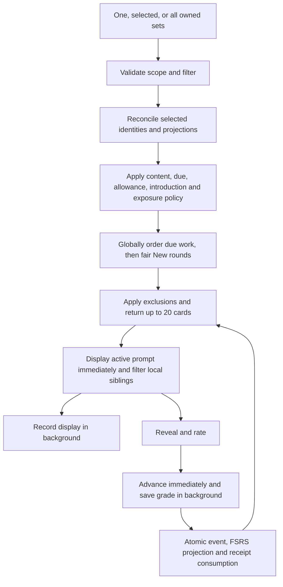

# Study flow: implementation state and remaining plan

Updated **12 November 2026**. This document replaces the original 9 November audit and its superseded proposals with the implemented behavior and remaining work. Steps 1–3 are complete; rewards, history, and streaks remain in step 4.

## Implementation checklist

1. [x] Recognition first, production second.
2. [x] Note exposure and the 2 am repetition gate, with immediate client transitions.
3. [x] Study one, selected, or all sets; due-only filtering.
4. [ ] Leaves, durable daily activity, history, and streaks.

### Step 1 — Introduction order: complete

A genuinely new note starts with recognition (source → target). Its first saved introduction unlocks production (target → source); saving production unlocks typing, forms, and examples. These introductions may happen on the same day. A due Learning return can appear before the next New introduction; recognition need not graduate before production is introduced.

Queues, ready counts, and submissions enforce saved prerequisites. Short batches, exclusions, missing content, suspension, or burial cannot bypass them. Existing studied/imported exercises retain their progress. Native history and import baselines restore missing/outdated FSRS projections without inventing reviews. A refill requested during an older fetch runs after it finishes so newly unlocked siblings become available promptly.

Implementation: [policy order](../src/lib/review/policy.ts), [SQL prerequisites](../src/db/studyPolicy.ts), [queue/submission](../src/db/reviewRepo.ts), and [regression coverage](../tests/studyIntroduction.test.mjs).

### Step 2 — Exposure and immediate transitions: complete

**Confirmed policy:** New/Learning are initial learning; Review/Relearning are repetition for exposure filtering. Every displayed card attempts to record exposure. Only recognition, production, and typing in Review/Relearning defer after any prior exposure of that note during the current study day. New/Learning and forms/examples bypass the gate but still contribute exposure. Only New shows Ok; the existing grading controls are unchanged.

Exposure resets at **2 am in the saved study time zone**, default UTC, rather than after a rolling 24 hours. Resolve local boundaries through PostgreSQL: a nonexistent spring 2 am moves past the gap; an ambiguous fall 2 am uses the later occurrence. A 10-minute Learning return remains eligible when due. A sensitive Review → Again/Relearning return after exposure waits until the next study day. Stored FSRS due dates are preserved; effective availability also respects burial and the exposure reset.

The note's `lastExposedAt` is the eligibility source. Minimal `study_exposure` receipts identify presentation retries and allow one completion per presentation. All types share the same note marker, including displays with no saved grade. No separate note-day table or exposure-history scan is needed.

Queues apply eligibility before their 20-card limit and choose one sensitive repetition per note before exclusions. The browser shows the active buffered card immediately, marks its note locally, filters waiting sensitive siblings and stale refill responses, and records its display in the background. Prefetch does not mark exposure. Reading, typing, reveal, rating, and advancement never wait for confirmation. Exposure errors are silent; late responses do not replace the prompt or clear input. Focus and 2 am refresh visibility and eligibility while preserving the answer.

This immediate flow is the user's explicit choice after the original strict-before-display implementation (`39b5223`). **Cross-device exclusion of already-buffered cards is best effort.** A stale reported display still records actual exposure. A lost marker request does not prevent saving its rating: the grade can create the missing receipt without consulting prior exposure. Confirmed exposure remains after failed/abandoned grades; an unconfirmed ungraded display can be lost on close. Ownership, due/state, prerequisites, allowance, presentation consumption, and write-conflict checks still protect saves.

Activation repairs only the active card's projection; only New recognition checks its set's unseen cohort. Exposure invalidates cached readiness without refetching the library per display. Grades atomically append the event, update the FSRS projection, consume the receipt, and renew exposure using Neon HTTP batches.

Implementation: [migration/backfill](../migrations/0013_study_exposure.sql), [study-day resolution](../src/db/studyDay.ts), [SQL gate/effective availability](../src/db/studyExposurePolicy.ts), [exposure persistence](../src/db/studyExposureRepo.ts), [client hook](../src/components/review/useStudyExposure.ts), and [database coverage](../tests/studyExposure.test.mjs).

**Deployment:** apply all of `0013_study_exposure.sql` before using the exposure-aware reviewer, including the native-review backfill omitted by a schema-only push. Imported source logs and historical ungraded displays do not seed exposure. No external database was migrated during this work. The new-word allowance still resets at midnight; aligning it to 2 am remains a product decision.

### Step 3 — One, selected, or all sets: complete

The common [study page](../src/app/study/page.tsx) and [shared handlers](../src/lib/review/routes.ts) use the existing scheduler for every scope:

```ts
type StudyScope = { kind: "all" } | { kind: "sets"; setIds: string[] };
type StudyFilter = "all_available" | "due_only";
```

- `/study?scope=all` studies every owned set, across language pairs.
- `/study?scope=all&filter=due_only` includes due Learning/Review/Relearning and excludes missing or persisted FSRS New projections.
- `/study?scope=sets&set=<uuid>&set=<uuid>` studies an explicit selection; `filter=due_only` also applies here. A one-ID selection is single-set study.
- `GET /api/study/queue` validates scope/filter/exclusions, returns up to 20 eligible cards and effective timing/day metadata.
- `POST /api/study/activate` records a presentation; `POST /api/study/reviews` saves a rating. Both derive the owned set from the card, rather than trusting a session's single set ID.
- Existing `/anki/[id]/review` URLs and `/api/word-sets/[id]/review[/exposure]` endpoints remain wrappers. Legacy API mutations retain their set constraint.

Explicit selections require 1–100 UUIDs. Duplicate IDs are normalized, including case, without multiplying work; the size cap applies before deduplication. Invalid or empty selections return 400; any foreign, missing, or deleted selected set returns 404. A valid empty set produces an empty queue. An explicit empty list never widens to all sets, including during identity/projection reconciliation. Exclusions require UUIDs and are capped at 100.

One SQL candidate query applies ownership, content, suspension/burial, saved introduction prerequisites, due time, independent per-set allowances, and exposure policy before LIMIT. Due scheduled cards are globally ordered by due time across sets. New cards follow fair rounds of each set's eligible introduction/word order, with stable set/card tie breakers. Ranking and unseen cohorts precede exclusions, so refills cannot open extra unseen words. Selected-subset reconciliation uses array predicates rather than separate per-set queues.

The library offers **Study all available**, **Repeat due only**, selection checkboxes, **Study selected (count)**, a selected-scope due-only toggle, and clear selection. Search does not narrow the all-sets action or discard hidden selections. The quota hint multiplies the saved daily limit by the selected/all set count: five fresh sets can admit up to 100 words at the default of 20 per set. There is no new user-wide allowance.

`ReviewSession` takes scope/filter, preserves them on refills, and keeps the active card stable. Its header shows the current set, actual exercise direction, scope size/all sets, and due-only mode. Pronunciation uses the current card's source language. The completion message explains when New exercises were excluded. Successful grades invalidate set readiness and the global `studyActivity` cache namespace reserved for step 4; exposure only invalidates readiness. No session-local reward counter was introduced. Leaves and the activity endpoint do not exist yet.

Note UUIDs retain the same schedules, history, and exposure across all scopes. Identical text saved as separate notes remains independent; cross-set text deduplication is outside this revision.

Implementation: [scope validation/URLs](../src/lib/review/scope.ts), [owned scope/card resolution](../src/db/studyScope.ts), [shared queue](../src/db/reviewRepo.ts), [scope-aware counts](../src/db/reviewStatsRepo.ts), [library actions](../src/components/anki/StudyScopeActions.tsx), [reviewer](../src/components/review/ReviewSession.tsx), and [scope regression coverage](../tests/studyScopes.test.mjs). No schema migration is needed for step 3.

## Current exercise and scheduling contract

A note owns five stable exercise identities. Missing content hides dependent exercises without deleting their history. A basic note with source/translation has three exercises; complete notes can have five.

| Key           | Prompt → answer                     | Required content       |
| ------------- | ----------------------------------- | ---------------------- |
| `recognition` | Source word → translation           | Source and translation |
| `production`  | Translation → source word           | Source and translation |
| `type_answer` | Translation → typed source word     | Source and translation |
| `word_forms`  | Source word → word forms            | Source and forms       |
| `example`     | Translated example → source example | Both example sentences |

Each exercise retains its independent FSRS state/history. Typing comparison is feedback; the learner chooses the rating. Forms and examples can expose related content, and revealed answers may show forms, example pairs, and comments. This is why all displays contribute note exposure.

Due work precedes New introductions. Learning, Review, and Relearning use global due-time order; there is no additional short-step priority. Imported baselines and native history restore projections before selection. New material must be due/eligible and obey its set's allowance; all-available does not pull future work forward. Import suspension/burial and saved prerequisites remain effective in every scope.



## Remaining work

### Step 4a — Leaves and durable activity

These are proposed defaults, not implemented rewards:

| Item                  | Proposed rule                                                                                   |
| --------------------- | ----------------------------------------------------------------------------------------------- |
| Completion            | One successfully saved native review/introduction, across every set/type                        |
| Included              | New-card Ok, Again/No, other saved ratings, genuinely due repeats                               |
| Excluded              | Fetch/reveal only, failed/ignored writes, duplicate retries, imported logs, projection rebuilds |
| Leaf size             | 20 saved completions                                                                            |
| Scope                 | User-wide across sets, selected scopes, and sessions                                            |
| Daily leaves/progress | `floor(todayCompletions / 20)` and `todayCompletions % 20`                                      |
| Daily boundary        | Proposed alignment to resolved 2 am in the saved study zone                                     |
| Partial chunks        | Proposed daily reset; carryover remains undecided                                               |
| Streak qualification  | Proposed any saved completion; no full leaf required                                            |

For example, 12 completions in set A and 15 in B yield 27 today: one leaf and 7/20. Again counts effort, avoiding incentives to inflate ratings. An abandoned exposure earns nothing.

Add `study_activity`, one receipt per native completion, unique by original `reviewId`. Store user, server-accepted completion time, immutable credited date, time-zone snapshot, template key, and optional note/set snapshots or nullable attribution. Activity must survive note/set deletion; account deletion may cascade. Review events currently cascade with deleted content, so surviving FSRS history alone cannot preserve earned effort.

Require a stable review UUID in the new contract (currently optional at the API). Append the event, FSRS update, presentation consumption, and activity receipt in the same atomic Neon HTTP batch. Validate any retained client scheduler timestamp against an agreed skew policy. A retry after rollover must return its original credited day. Imported progress, replay, and failed writes never award activity.

Start with indexed receipts and bounded activity queries, including `GET /api/study/activity`. Add daily aggregates only if measurements justify them. Earned leaves need no wallet while there is no spending. If spending is introduced, add an idempotent wallet ledger with unique award ordinals and atomic debits.

**Acceptance:** 19 → 20 → 21 and 39 → 40 saves yield correct global progress across sets/sessions. Retries count once, failures zero, concurrent thresholds award once, deleting a set retains rewards, and imports/rebuilds award none.

### Step 4b — History, streaks, and completion messaging

Return a bounded, zero-filled calendar range, such as 365 study dates, with completion counts and leaves. Use completions for heatmap intensity so partial-leaf days remain visible; provide text/tooltips and an accessible list/table equivalent.

Calculate current and longest streaks from credited calendar dates. If today is still empty but yesterday was active, retain the current streak until today ends. Snapshot day/time-zone attribution so preference changes do not rewrite history. Define and test the effectiveness of study-zone changes, including travel and DST; proposed policy is at the next boundary with one shared day context.

Leaf milestones should offer Continue/Finish without discarding buffered work. Completion/waiting messages should distinguish exposure deferral, future due times, exhausted allowance, due-only filtering, and partial daily effort. Pending saves must remain visibly pending before exit; confirmed rewards survive reload. Update the current behavior sections of the companion study docs as rewards ship.

**Acceptance:** zero/partial/full-leaf days, 2 am rollover/DST, yesterday-active streaks, and rejoining partial progress behave as agreed. Durable activity remains global when study scopes change.

### Decisions before step 4

| Decision             | Suggested default                                 | Alternative                                 |
| -------------------- | ------------------------------------------------- | ------------------------------------------- |
| Allowance/reward day | Align to the existing 2 am exposure boundary      | Keep distinct boundaries                    |
| Partial daily chunks | Reset at study-day rollover                       | Carry progress across days                  |
| Streak day           | Any saved exercise                                | At least one full leaf                      |
| Time-zone changes    | Effective at the next boundary                    | Another explicitly tested transition policy |
| Historical activity  | Backfill retained native history with zone caveat | Start at launch                             |
| Leaves               | Earned totals without spending                    | Wallet and ledger now                       |

Historical backfill cannot recover deleted reviews or historical ungraded displays. Where no time-zone snapshot exists, the current zone is only an approximation. Define this policy before running a data migration.

### Separate follow-ups

- Presentation receipts currently remain until note/account deletion. Define retry/resume retention before adding timed cleanup; preserve pending attempts and idempotency.
- Measure representative queue/activation/save latency, query counts, SQL plans, skipped candidates, and post-grade library refetches before adding indexes, session caches, aggregates, or write queues. No production throughput benchmark exists.
- Background requests, `keepalive`, and in-memory retries do not guarantee delivery after close. A persistent browser outbox is a separate feature. Exposure confirmation intentionally remains best effort.
- A user-wide new-word allowance, cross-set text deduplication, preferential short-step scheduling, and merging typing into production require separate product/history-migration decisions.

## Verification

Step 1 checkpoint: 418 tests, typecheck, production build, and changed-file lint passed. Step 2 loading follow-up checkpoint: 477 tests, typecheck, production build, changed-file lint, formatting, and whitespace checks passed. These are historical checkpoint totals.

Step 3 validation: **508 tests passed**, typecheck and the standard Turbopack production build passed, and changed-file lint, formatting, and whitespace checks passed. The scope tests cover global due priority, fair mixed-type/sparse-position rounds and refills, independent fixed allowances, due-only states and counts, subset reconciliation, cross-scope exposure, UUID/list-size/ownership checks, empty/foreign/deleted sets, mutation retries, and mixed-language rendering/audio. A preexisting move-test fixture now pins card creation to its fixed clock so it remains valid after that calendar date.

Full-repository lint still reports preexisting errors in `TranslationSelector.tsx`, `WordInput.tsx`, and `TextAnalyzer.tsx`; none are changed here. Verification uses in-memory PostgreSQL and mocked component checks. No browser automation or remote migration was used. Browser layout, keyboard interaction, and audio playback remain for the user's manual checks below.

### Manual checklist for the user

1. Select two sets with different language pairs, then **Study selected**. Only those sets appear; the set name, exercise direction, and pronunciation language follow each card. Reopen a bookmarked single-set review URL and confirm it still works.
2. Use **Study all available** while the translation screen has a different language pair selected and while the library search hides some sets. All owned sets remain included. Selected sets hidden by search remain selected until cleared.
3. Compare **Repeat due only** and the selected-scope due-only toggle with all-available. Due Learning/Review/Relearning remain; New exercises disappear. Future, suspended, buried, and exposure-blocked cards remain unavailable. The empty due-only screen explains that New exercises are excluded.
4. Combine a set of fresh words with another set's overdue cards. Due cards appear first globally, then New material alternates fairly across eligible set streams. The quota hint uses the saved per-set limit; each set retains its own allowance.
5. Display a mature sensitive card, then reopen through a different scope or tab. Future queues defer that note's sensitive repetitions until 2 am; New/Learning and forms/examples remain eligible. Slow/failed exposure requests must leave reveal, typing, ratings, and advancement usable.
6. Use selection checkboxes, clear selection, search, and start actions with keyboard navigation at narrow and wide widths. Zero selected sets disables **Study selected**. A malformed/empty selection URL shows an error rather than studying all sets.
