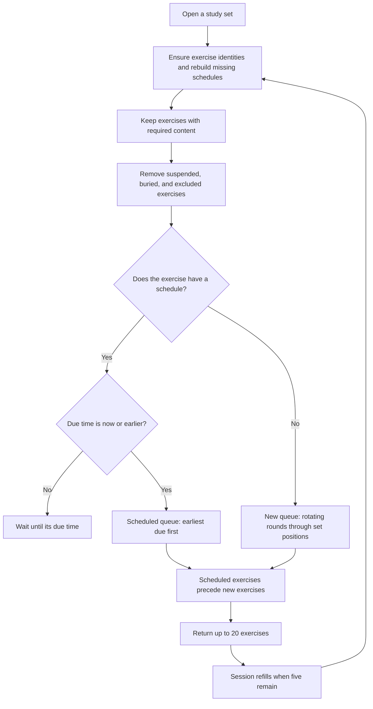
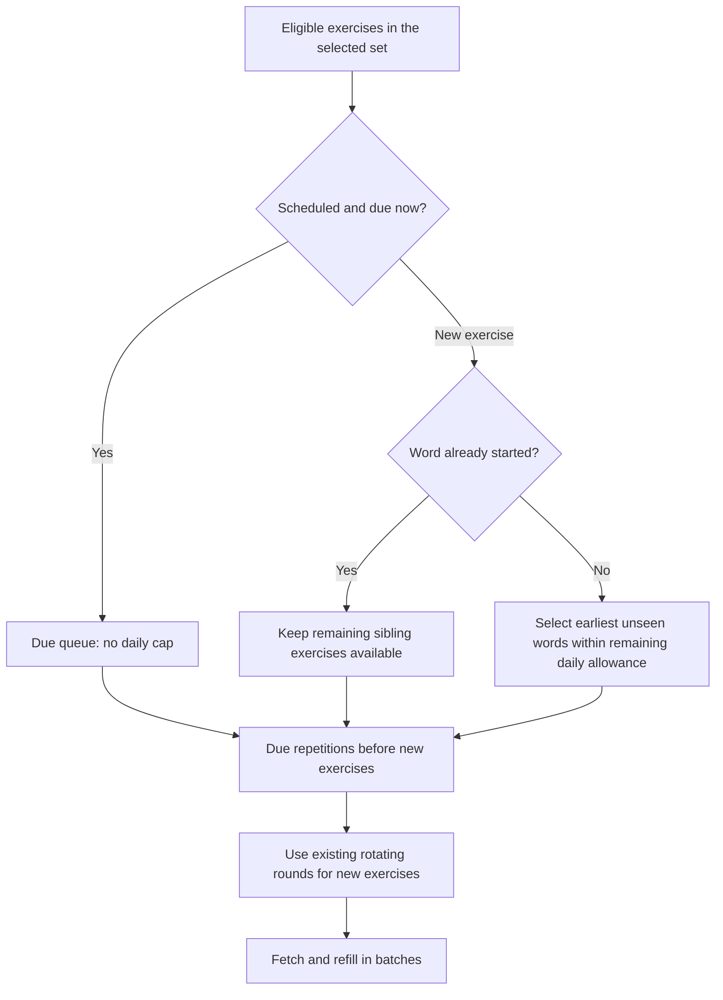

# Study order, daily limits, and reviews

Audited against `main` at `fd79c50` on 11 October 2026. The first sections describe that revision. The final sections describe the changes in this working tree.

## A word has several independent exercises

A study set contains ordered vocabulary notes (`word_set_item`). Each note owns five stable exercise identities (`study_card`), but only exercises whose required content is present can appear:

| Exercise        | Prompt → answer                     | Required content       |
| --------------- | ----------------------------------- | ---------------------- |
| Recognition     | Source word → translation           | Source and translation |
| Production      | Translation → source word           | Source and translation |
| Word forms      | Source word → forms                 | Source and forms       |
| Type the source | Translation → typed source word     | Source and translation |
| Example recall  | Translated example → source example | Both example sentences |

Consequently, a basic word normally has three available exercises; a complete word can have five. A set of 20 complete words can introduce **100 exercises**, before counting repetitions. Answering recognition does not schedule or complete the other four exercises. Each has its own FSRS memory state, due time, and review history.

Definitions: [`templates.ts`](../src/lib/review/templates.ts). Stable identities and availability: [`studyCardRepo.ts`](../src/db/studyCardRepo.ts). Storage: [`schema.ts`](../src/db/schema.ts).

## How the original server queue is constructed

Every request is scoped to one owned study set, rather than every set in the account.

The exact original SQL sort order is:

1. Exercises with an FSRS projection before exercises without one.
2. Earliest `due_at` first; absent dates last.
3. The exercise's round number.
4. The word's stored `position`.
5. The exercise UUID as a deterministic tie breaker.

Eligibility requires an absent schedule or `due_at <= now`. Learning, relearning, and established reviews all share the scheduled queue; the original implementation does not give short learning steps a separate priority above overdue established reviews. Imported schedules are restored before filtering, so an imported future review does not accidentally become a new exercise.

Implementation: [`getDueReviewCards` and `exerciseRoundOrder`](../src/db/reviewRepo.ts). Projection restoration: [`reviewProjectionRepo.ts`](../src/db/reviewProjectionRepo.ts).

## New exercises use rotating rounds

The order is **not recognition for every word, then production for every word**. It uses this fixed cycle:

`recognition → production → word_forms → type_answer → example → recognition`

For a word at zero-based position `p`, the starting exercise index is `p mod 5`. Its other exercises follow that cycle. Missing content removes an exercise and compresses that word's remaining rounds. The queue visits each word in position order for round 1, then again for round 2, and so on.

For five new words with complete content, read each table row from left to right, then move to the next row:

| Round | Word A, position 0 | Word B, position 1 | Word C, position 2 | Word D, position 3 | Word E, position 4 |
| ----- | ------------------ | ------------------ | ------------------ | ------------------ | ------------------ |
| 1     | Recognition        | Production         | Word forms         | Type the source    | Example recall     |
| 2     | Production         | Word forms         | Type the source    | Example recall     | Recognition        |
| 3     | Word forms         | Type the source    | Example recall     | Recognition        | Production         |
| 4     | Type the source    | Example recall     | Recognition        | Production         | Word forms         |
| 5     | Example recall     | Recognition        | Production         | Word forms         | Type the source    |

For two words with only source/translation content, the order is:

`A recognition → B production → A production → B type the source → A type the source → B recognition`

Important consequences:

- A word can be introduced through production, typing, forms, or an example before its recognition exercise.
- In a large fresh set, the first round can visit **every eligible word** before any word's second exercise.
- Round numbers are based on all content-eligible siblings, including answered and prefetched ones. Fetch exclusions do not restart the rounds.
- Missing content compresses rounds; suspension, burial, and existing schedules filter exercises afterward. This can leave gaps in a word's rounds.
- There is no automatic sibling burial. Other exercises of the same word can be studied on the same day, including back-to-back when few words remain.
- The stored set position drives the rotation, so gaps or changes in positions can change a word's starting exercise.

Executable examples: [`studyCardQueries.test.mjs`](../tests/studyCardQueries.test.mjs).

## What the original “20” means

**20 is a network batch size, not a daily word limit or session limit.** The review route requests up to 20 exercises. The client refills when five remain. The repository clamps any requested batch size to 1–50 exercises.

At the audited revision, there is no cap on new words per day, no cap on new exercises per day, and no total session cap. A learner can continue through the whole set while it has available exercises.

Batch constant: [`review/route.ts`](../src/app/api/word-sets/[id]/review/route.ts). Refill logic: [`ReviewSession.tsx`](../src/components/review/ReviewSession.tsx).

## Where reviews appear and when words return

Previously studied exercises whose due time has arrived enter the same study session, ahead of new exercises in each server response. Their order follows due time, not original word order. Due reviews from another study set are not included.

The library's “exercises ready” count originally included both new exercises and scheduled due exercises. It was not a count of previously learned words waiting for review. Likewise, a word can be labeled “New” while another of its exercises has already been learned; the label summarizes its siblings.

The built-in FSRS adapter uses 90% desired retention, learning steps of 1 and 10 minutes, a 10-minute relearning step, and no interval fuzz. A new exercise has only **Ok**, which submits **Good**; with these steps its first repetition is due in 10 minutes. Once learning, Simple mode maps No/Yes to Again/Good; Full mode exposes all four ratings. Subsequent intervals depend on that exercise's state and rating. Typing feedback does not choose the rating automatically.

An exercise due in 10 minutes is not shown early. The original session has no due-time timer, and can show “caught up” while learning exercises are waiting for their next step. Reopening the set after their due time makes them available again.

There is also a client ordering gap in the original implementation: refills append incoming cards after the existing in-memory queue. If a repetition becomes due after new cards were prefetched, it can sit behind those new cards despite being first in the next server response. Thus the original server prioritizes due work, but the client does not continuously enforce that priority.

Scheduling: [`fsrs.ts`](../src/lib/review/fsrs.ts). Button mapping: [`controls.ts`](../src/lib/review/controls.ts). Ready counts: [`reviewStatsRepo.ts`](../src/db/reviewStatsRepo.ts). Client buffering and save behavior: [`optimistic-review-updates.md`](optimistic-review-updates.md).

## Relation to Anki

Anki's order is configurable: its New/Review Order can show new cards after reviews, and Card Type Then Order Gathered can show one direction across gathered words before another direction. Anki also offers sibling burial and counts its daily new limit in **cards**, rather than vocabulary notes. See the [official deck options manual](https://docs.ankiweb.net/manual/deck-options).

Those are separate decisions: scheduling each exercise with FSRS does not itself determine the order in which new exercises are introduced.

## Changes in this working tree

The requested first change is a **Study set settings** block in Profile:

- **New words per day per set:** default 20; configurable from 0 to 1,000. Zero pauses completely unseen words.
- **Study time zone:** defaults to UTC; can be changed or filled from the device's time zone. The allowance resets at midnight in the saved zone, including daylight-saving transitions.
- These are account preferences applied independently to each set. Studying 20 new words in set A does not consume set B's allowance.

A word consumes one daily slot when its first native review is saved. Prefetching does not consume a slot. The permitted unseen words are selected in set position order **before** card batching or exclusions, so fetching another batch cannot move on to another group of 20. Unused allowance does not accumulate.

Already-started words keep all their eligible sibling exercises available, even on later days or when the setting is zero. Imported studied progress also makes a word already started; importing it does not spend today's new-word allowance. The count comes from canonical review history and imported baselines, so rebuilding the FSRS projection does not reset it. Empty words and words whose exercises are all suspended/buried do not occupy an unseen-word slot.

This deliberately limits **new words**, as requested, rather than Anki's **new cards**. It can still introduce up to five exercises for each admitted word, plus remaining new exercises of words started earlier.

Ready counts now honor the new-word allowance. Due learning/relearning/review exercises remain uncapped. Imported projections still in state New are treated as new material for ordering.

The client merges newly due scheduled exercises ahead of waiting new exercises, preserves the currently displayed prompt, and refreshes at the next scheduled due time or when the window regains focus. It refills when five scheduled exercises remain even if many new exercises are buffered, so the new-material buffer cannot delay fetching the remaining review backlog. Returning exercises can therefore be next after the active exercise without interrupting an answer in progress. Queue responses merge against the live queue, so an answer submitted during a refill does not reappear from an old queue snapshot.

The completion screen describes the daily allowance and shows the next scheduled repetition when one exists. The exercise rotation, rating controls, and FSRS settings are unchanged.

Implementation: [`studyAllowance.ts`](../src/db/studyAllowance.ts), [`profileRepo.ts`](../src/db/profileRepo.ts), [`ProfileClient.tsx`](../src/components/profile/ProfileClient.tsx), [`queue.ts`](../src/lib/review/queue.ts), and [`ReviewSession.tsx`](../src/components/review/ReviewSession.tsx). Regression checks: [`studyAllowance.test.mjs`](../tests/studyAllowance.test.mjs), [`reviewQueue.test.mjs`](../tests/reviewQueue.test.mjs), and [`reviewSession.test.mjs`](../tests/reviewSession.test.mjs).

Apply [`0012_study_set_settings.sql`](../migrations/0012_study_set_settings.sql) before running this application version against an existing database. This task does not apply migrations to a remote database.

## Manual verification

1. Open Profile. Set the daily limit to 2, choose your study time zone, save, and reload. Both values should persist.
2. Open a set with at least three untouched words. New exercises should use only its first two eligible words. Finish or reopen the session: a third untouched word should not appear that day.
3. Open a different untouched set. It should have its own two-word allowance.
4. Set the limit to 0 and reopen a set with due reviews and untouched words. Due reviews and sibling exercises of started words should remain available; wholly unseen words should be paused.
5. Introduce an exercise with Ok. After its displayed 10-minute interval, keep the review page open or return focus to it. The repetition should appear before waiting new material, after the currently displayed exercise.
6. In a fresh set, check the rotation against the tables above. Optional exercises should disappear when their required content is missing.
